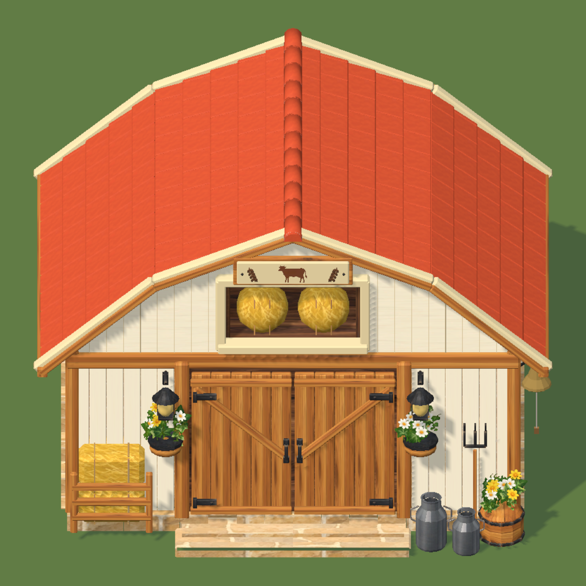
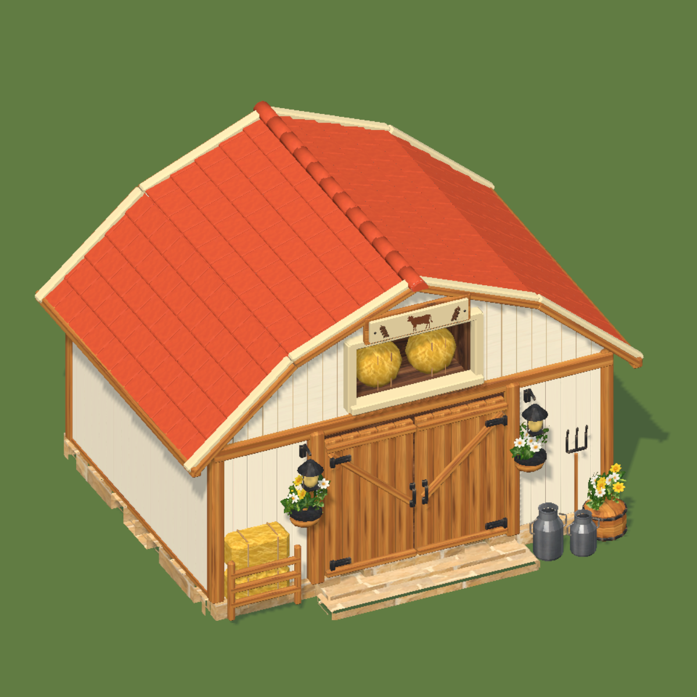
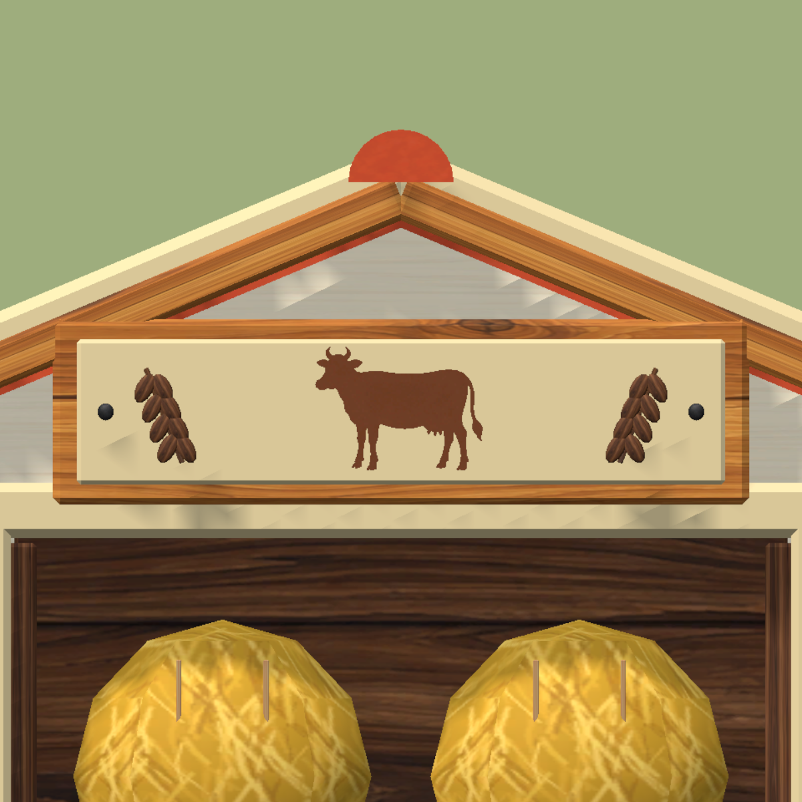

# Eksterior kandang sapi player — Cozy

3 November 2026. Acuan: `Source~/BarnExteriorCozy/BarnExterior_Target.png`. Ini kandang ternak milik player, bukan Barn Store.

## Hasil

Atap gambrel terakota merah dengan genteng persegi bertumpuk, bevel dan nok membulat. Rangka kayu madu, lis krem tebal, dinding papan ivory, fondasi dan anak tangga batu. Pintu ganda berpenguat V dengan engsel serta handle besi. Loteng benar-benar terbuka, memiliki kedalaman dan dua gulung jerami. Papan atas berisi siluet sapi tampak samping dan ukiran gandum. Dua lampu fasad, planter gantung, rak jerami kiri, dua milk can aluminium, garpu tiga mata dan barrel bunga kanan mengikuti susunan referensi.

Bell interaktif lama dipertahankan dan ditempatkan di sisi kanan bangunan, dengan penyangga besi. Lokasi pendekatannya berada di luar dinding dan terpisah dari pintu utama. Tidak menambah hewan atau pickup dekorasi.

Bagian belakang yang tidak terlihat pada acuan diselesaikan dengan dinding tertutup dan bahan yang konsisten. Detail render referensi disesuaikan menjadi geometri dan material game; hasil bukan salinan piksel gambar. Lighting menggunakan shader Cozy di Unity.

## Atlas, sumber dan LOD

Semua permukaan bangunan baru memakai material atlas bersama `NP_CozySurfaces_01`, `NP_CozySurfaces_02`, `NP_CozyFoliage_01`, `NP_CozyGlow_01`, dan halaman emblem `NP_CozyEmblems_01`. Tidak membuat tekstur per objek atau mengubah slot atlas lama. Bell lama tetap memakai atlas sumbernya.

| Mesh | Triangle | Slot material |
| --- | ---: | ---: |
| LOD0 | 26.644 | 5 |
| LOD1 | 13.274 | 4 |
| LOD2 | 4.084 | 4 |

Atap memiliki lapisan terakota tertutup di bawah genteng agar sambungan antar kemiringan tidak memperlihatkan celah. Fondasi, underlay dan siluet sapi dipertahankan saat penyederhanaan LOD. Model dan tiga LOD tersimpan di `Source~/BarnExteriorCozy/BarnExterior_Cozy_Master.blend`; tekstur dikemas dalam file Blender. FBX sumber dan mesh Unity berada di `mesh/Buildings/BarnExteriorCozy/`. Studio Blender tidak ikut diekspor. Tidak menambah realtime light baru.

## Integrasi dan pengujian

Lima prefab visual exterior yang tersedia memakai model baru dengan skala level sebelumnya. GUID, root ID, posisi/skala model, anchor pintu dan referensi bell dipertahankan. Komponen collider badan tetap sama, tetapi ukuran/pusatnya diselaraskan dengan badan bangunan yang kini simetris dan tertutup. Collider tambahan yang ada tetap dipertahankan.

Definisi bangunan, biaya, durasi, footprint, kapasitas level 1–4, interior, scene, save produksi, Coop dan atlas bersama tidak diubah. Menu exterior Barn A/B lama meneruskan ke setup Cozy agar tidak mengembalikan tampilan lama secara tidak sengaja.

Unity 6000.0.81f1 native diuji di proyek terpisah: **155 pemeriksaan lulus**. Meliputi mesh/UV/bounds/triangle/material, identitas prefab, akses capsule ke pintu, bell yang masih dapat berayun, pemisahan area bell/pintu, atap utuh pada tiga LOD, serta restore bangunan Barn level 1–4 pada rotasi 0°, 37°, 90°, 180°, 270° menuju BarnInterior. Audit lengkap dan preview tiap LOD tersimpan di `BarnExteriorCozyReview/`.

Hasil yang telah diuji disalin ke prefab utama beserta metadata dan runtime mesh; referensi GUID dicocokkan dengan aset utama. Jika Unity masih Play, Stop lalu Play/load ulang agar instance memakai prefab baru. Untuk membangun ulang binding di Edit Mode: **Nature Paradise > Art > Apply Cozy Player Barn Exterior**. Belum dilakukan pengukuran performa pada perangkat mobile fisik.

## Logo sapi hasil image generation

Atas permintaan user, siluet geometri manual diganti PNG hasil built-in imagegen. Master dan prompt lengkap tersimpan di `Source~/SharedAtlas/Emblems01/`. GIMP hanya melakukan resize/packing sambil mempertahankan alpha dan bentuk hasil generasi.

Runtime memakai atlas emblem RGBA **512 x 256** (normal/mask tidak diperlukan), mipmap dan ASTC 6x6 Android/iPhone. PNG ditempel pada quad dua triangle di depan papan, dipertahankan di semua LOD, dengan satu material cutout bersama tambahan. Halaman atlas bangunan 01/02 tidak diubah. Pemeriksaan tambahan memverifikasi ukuran PNG, exterior transparan, serta interior sapi opaque. Total **155 pemeriksaan Unity lulus**.

