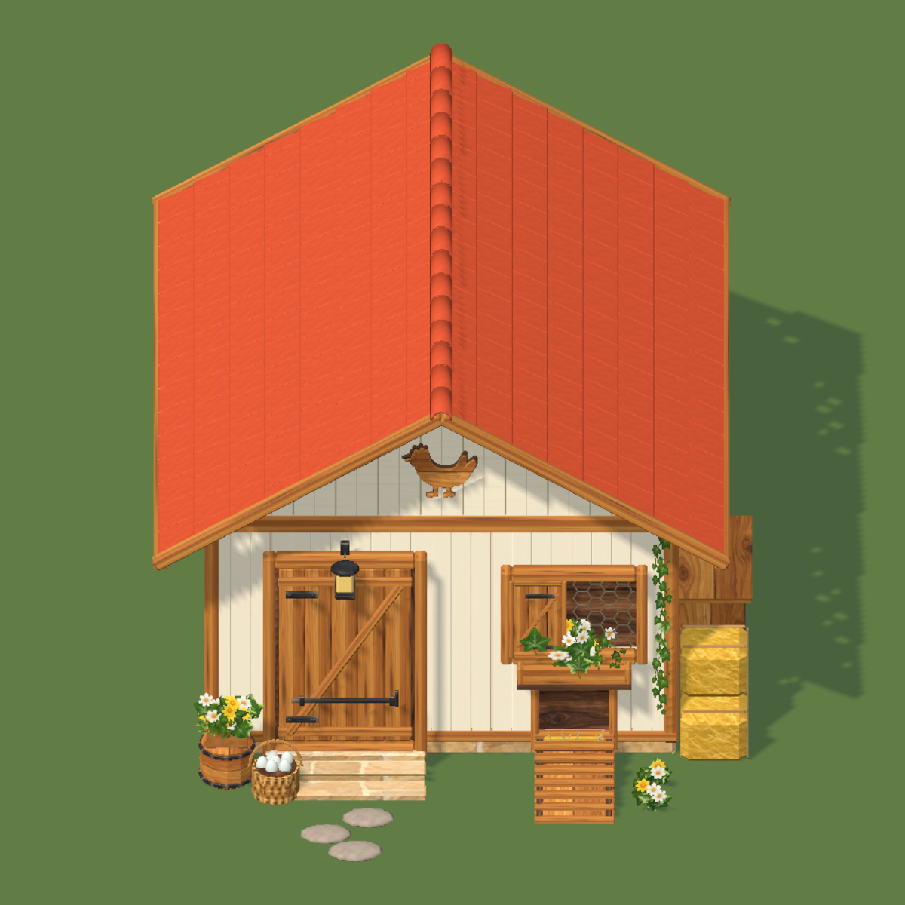
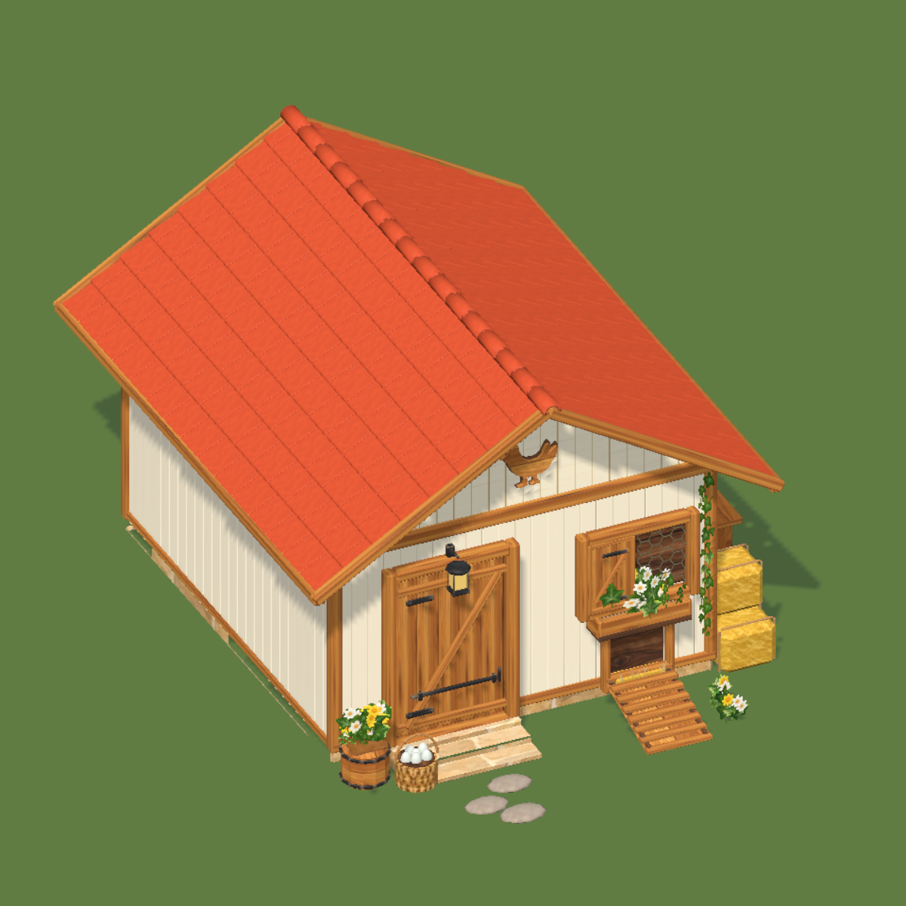
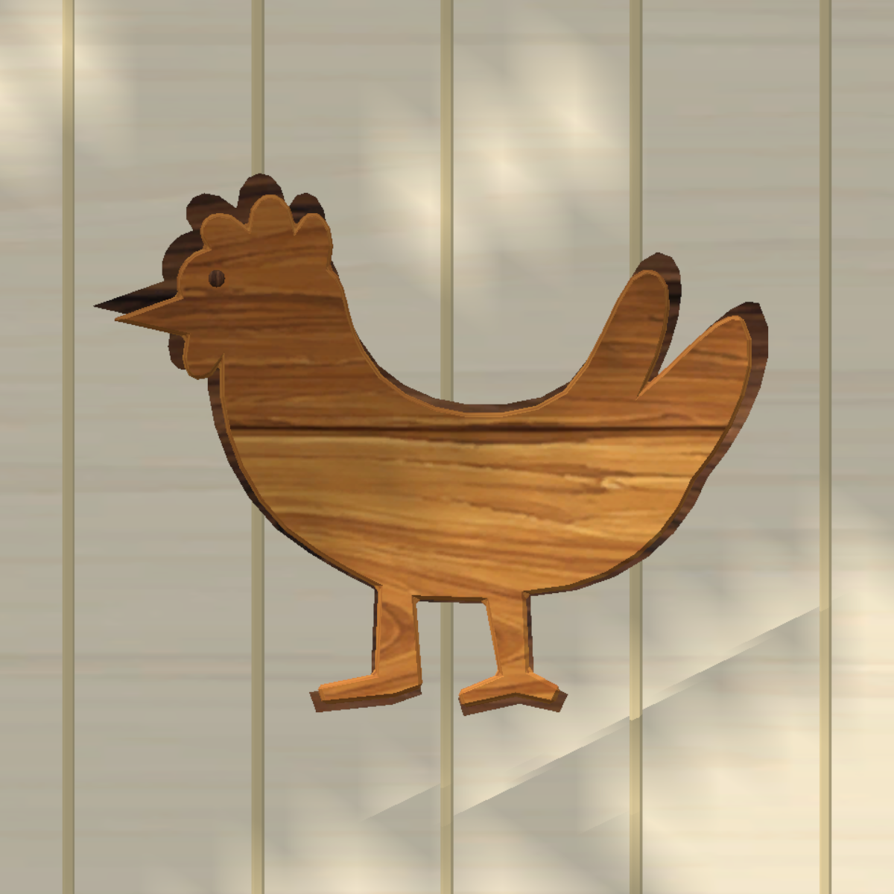

# Eksterior Coop player — Cozy + atlas tambahan 02

3 November 2026. Acuan: panel kanan `Source~/CoopExteriorCozy/CoopExterior_Target.png`.

## Hasil yang diterapkan

Eksterior Coop milik player sudah dipasang pada lima prefab visual yang tersedia. Pintu kiri, shutter dan jendela kawat kanan, bukaan ayam dengan ramp, genteng terakota persegi bertumpuk, nok melengkung, papan krem, kusen madu, emblem ayam, lentera, ivy, planter, bal jerami, keranjang telur, dan pijakan batu mengikuti komposisi referensi. Sisi belakang yang tidak terlihat pada referensi dilengkapi dengan bahan dan konstruksi yang konsisten. Hasil bukan salinan piksel render referensi; pencahayaan memakai shader game.

Keranjang berisi enam telur dekoratif, tanpa pickup atau hewan otomatis. Companion coop di Chicken Store dan interior Coop tidak diubah.

## Atlas bersama

Atlas lama tetap utuh. Halaman tambahan `Textures/Shared/Cozy/NP_CozySurfaces_02_BaseColor.png` berukuran 1024²; normal dan surface mask masing-masing 512². UV aman dan nama slot tersedia di `NP_CozyAtlasSlots_02.json`.

| Slot | Pemakaian |
| --- | --- |
| RoofClayClean | Genteng dan nok berbentuk 3D |
| RoofClayTiled | Pola genteng untuk LOD jauh |
| WoodCreamClean | Papan krem bersih |
| RiverStone / RiverStoneMoss | Batu alam dan batu berlumut untuk revisi berikutnya |
| ChickenWire | Kawat heksagonal dengan lubang alpha |
| PaintTeal / BrassWarm / TimberCream | Palet peralatan dan lis bersama |
| HayGold | Jerami emas halus |

Base color dirakit berlapis di GIMP. Normal dibuat terpisah dari relief halus, bukan dari bayangan lukisan. Mask memakai kanal merah metallic dan alpha smoothness. Kawat menggunakan alpha clip, tanpa sampling normal/mask. Impor Android/iPhone memakai ASTC 6×6, mipmap, clamp dan aniso 2.

## Model dan integrasi

- Sumber editable: `Source~/CoopExteriorCozy/CoopExterior_Cozy_Master.blend`, berisi modul, mesh LOD dan studio review. Tekstur dikemas dalam blend.
- Sumber atlas editable: tiga XCF di `Source~/SharedAtlas/Extension02/`.
- LOD0: 28.348 triangle / 5 slot material bersama; LOD1: 13.852 / 5; LOD2: 3.572 / 3. LOD jauh membuang kawat dan foliage.
- Runtime mesh: `mesh/Buildings/CoopExteriorCozy/CoopExterior_Cozy_Runtime.asset`, dinormalisasi dari FBX menggunakan penanda sumbu. Tidak bergantung pada instalasi Blender saat game berjalan.
- GUID prefab, root ID, skala level, posisi model, collider badan/nest, dan anchor pintu lama dipertahankan. Rotasi model dinormalisasi agar fasad dan anchor sesuai.
- Definisi bangunan, biaya, durasi, footprint, kapasitas, scene, interior, dan save produksi tidak ditulis.
- Lentera memakai material glow bersama; tidak menambah realtime light.

Pemasangan sudah tersimpan di prefab utama. Jika Unity masih Play, Stop lalu Play/load ulang untuk membuat instance baru. Menu **Nature Paradise > Art > Apply Cozy Player Coop Exterior** dapat membangun ulang binding saat Edit Mode; menu exterior lama meneruskan ke setup ini.

## Verifikasi

Unity 6000.0.81f1 native, proyek pengujian terpisah: **141 pemeriksaan lulus**. Meliputi import, UV, bounds, triangle, shader, binding material, GUID, collider, akses capsule ke pintu, dan restore bangunan level 1–4 pada rotasi 0°, 37°, 90°, 180°, 270° menuju CoopInterior. Preview depan, perspektif, belakang dan tiap LOD diperiksa. Log lengkap: `CoopExteriorCozyReview/Audit.txt`.

Setelah diterapkan ke proyek utama, 24 file terlindungi (atlas lama, metadata prefab, interior, definisi bangunan) tetap identik dengan snapshot sebelum perubahan. FBX, tekstur, material, runtime mesh dan prefab utama dicocokkan hash dengan hasil yang diuji. Belum ada pengukuran performa pada perangkat mobile fisik.

## Revisi emblem ayam

Siluet dari beberapa bola/batang diganti dengan satu kontur ayam berkesinambungan: dada membulat, leher pendek, jengger, paruh, ekor menyapu, dua kaki dan jari terpisah. Relief kayu madu dengan rim kayu gelap menggunakan atlas yang sama. Seluruh LOD dibangun ulang; 141 pemeriksaan Unity tetap lulus.

